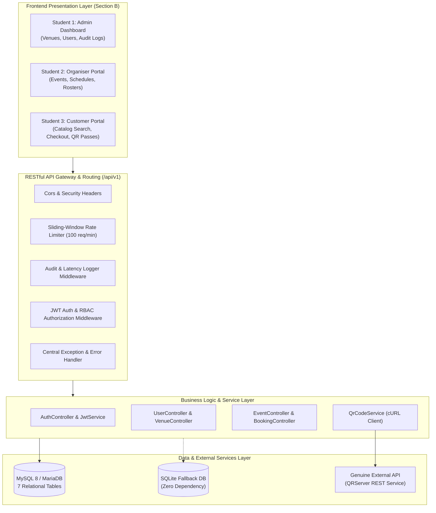
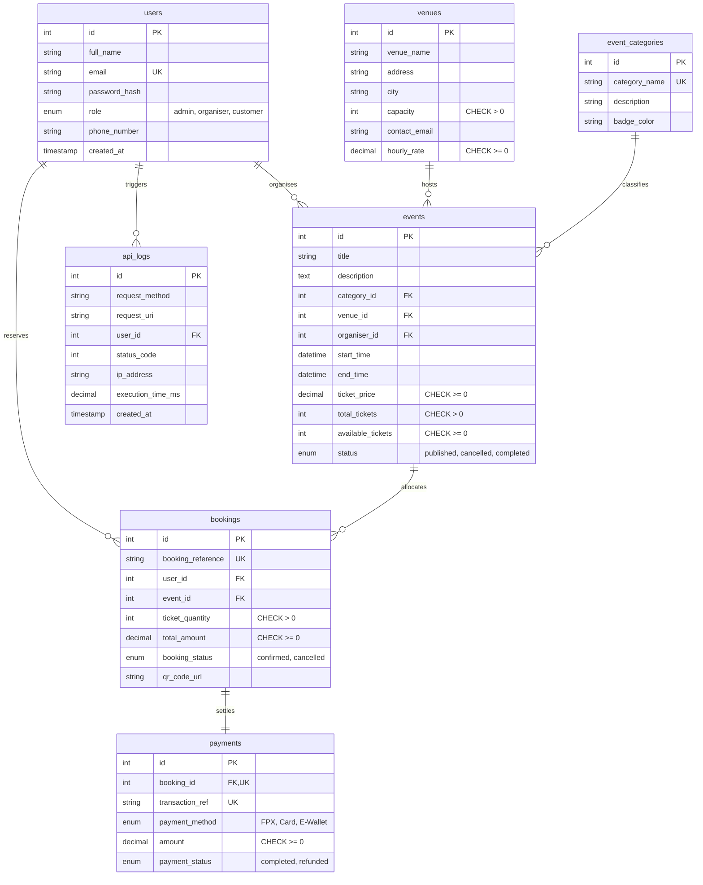

# Project Report: Development of a RESTful Web API for an Event Ticketing and Venue Booking System

**Course:** Web API Development (SWC3633/SWC4443)  
**Academic Program:** Bachelor of Information Technology (Honours)  
**Institution:** Universiti Poly-Tech Malaysia (UPTM)  
**Submission Date:** October 2026  

---

## Group Members & Contribution Details

| No | Full Name | Student ID | Program & Section | Role & Specialisation |
| :---: | :--- | :---: | :---: | :--- |
| **1.** | **Aidil Najmee Bin Che Jan** | **AM2412018166** | Section 3 | **Project Leader / Backend Lead Architect** Administrator Dashboard (`frontends/admin/`) |
| **2.** | **Team Member 2** | AM2412018167 | Section 3 | **Middleware & Business Logic Developer** Organiser Workstation (`frontends/organiser/`) |
| **3.** | **Team Member 3** | AM2412018168 | Section 3 | **External API & Quality Assurance Engineer** Customer Ticketing Portal (`frontends/customer/`) |

---

## Table of Contents
1. [System Overview](#1-system-overview)
2. [Database Design & Integrity](#2-database-design--integrity)
3. [RESTful API Documentation](#3-restful-api-documentation)
4. [API Testing & Verification](#4-api-testing--verification)
5. [System Implementation](#5-system-implementation)
6. [System Demonstration](#6-system-demonstration)
7. [Project Repository & Source Code Management](#7-project-repository--source-code-management)
8. [Additional & Advanced Features](#8-additional--advanced-features)
9. [Debugging & Performance Optimisation](#9-debugging--performance-optimisation)
10. [Individual Reflection and Contribution Records](#10-individual-reflection-and-contribution-records)

---

## 1. System Overview

### 1.1 Introduction & Problem Statement
Modern event operations—spanning technology conferences, music festivals, academic symposiums, and corporate conventions—require agile, interconnected digital platforms capable of orchestrating venue availability, attendee reservations, seat capacities, and admission security. Disjointed legacy systems frequently suffer from data inconsistencies, overselling anomalies under sudden traffic spikes, and lack of standardized interfaces for cross-platform integrations.

The **EventHub Ticketing and Venue Booking System** addresses these critical challenges by providing an enterprise-grade, decoupled RESTful Web API and modular frontend ecosystem. Built to fulfill Course Learning Outcome 3 (**CLO3 – Construct RESTful applications using appropriate methodologies**), the platform guarantees transactional integrity, strict role-based access control, rate limiting, and genuine external digital pass generation.

### 1.2 System Objectives
* **Standardized REST Architecture:** Construct an RFC-compliant HTTP/1.1 API delivering predictable JSON responses, proper HTTP status codes, and uniform URI naming across resources `/users`, `/venues`, `/events`, and `/bookings`.
* **ACID Data Integrity:** Prevent inventory race conditions and ticket overselling through database transactions, foreign key cascading rules, and check constraints.
* **Multi-Tier Security:** Enforce stateless JWT authentication (RFC 7519 HMAC-SHA256), API key verification, and Role-Based Access Control (RBAC) across three distinct user roles: Administrator, Organiser, and Customer.
* **External Integration:** Meaningfully integrate a genuine third-party external REST API (QRServer) via server-side cURL to generate verifiable digital entry passes.
* **Role-Specific Client Portals:** Provide three separately identifiable, functional frontend applications catering to administrators, organisers, and ticket-purchasing attendees.

### 1.3 Intended User Personas
* **Administrator:** Oversees system health, manages registered physical venues and seating limits, creates and moderates user roles, reviews global platform KPIs, and monitors live request latency logs.
* **Organiser (Staff):** Contracts venue spaces, configures multi-day event schedules, sets ticket prices and quotas, and accesses real-time attendee rosters for managed events.
* **Customer (Attendee):** Discovers conferences and concerts via live search and category filters, reserves ticket passes, executes payments, views entry QR passes, and initiates cancellations.

### 1.4 High-Level Architecture
The system adopts an N-tier decoupled client-server architecture:

---

## 2. Database Design & Integrity

### 2.1 Entity Relationship Diagram (ERD)
The relational database schema is normalized to Third Normal Form (3NF) and contains seven (7) related tables:
* `users`
* `venues`
* `event_categories`
* `events`
* `bookings`
* `payments`
* `api_logs`

### 2.2 Data Integrity Constraints
* **Primary Keys:** Auto-incrementing integer identifiers on all entities.
* **Foreign Key Constraints:**
  * `events.category_id -> event_categories(id)` (`ON DELETE RESTRICT`)
  * `events.venue_id -> venues(id)` (`ON DELETE RESTRICT` to protect active bookings)
  * `events.organiser_id -> users(id)` (`ON DELETE CASCADE`)
  * `bookings.user_id -> users(id)` (`ON DELETE CASCADE`)
  * `bookings.event_id -> events(id)` (`ON DELETE CASCADE`)
  * `payments.booking_id -> bookings(id)` (`ON DELETE CASCADE`, `UNIQUE`)
* **Domain Check Constraints:**
  * `venues.capacity > 0`, `venues.hourly_rate >= 0`
  * `events.total_tickets > 0`, `events.available_tickets >= 0`, `events.ticket_price >= 0`
  * `bookings.ticket_quantity > 0`, `bookings.total_amount >= 0`
* **Performance Secondary Indexes:**
  * `idx_user_email`, `idx_user_role`, `idx_event_status`, `idx_event_start`, `idx_event_price`, `idx_venue_city`, `idx_booking_ref`, `idx_log_status`.

---

## 3. RESTful API Documentation

The API adheres strictly to REST conventions. Key endpoints include:

| Method | Endpoint | Access Role | Description & Business Rules |
| :--- | :--- | :--- | :--- |
| `POST` | `/api/v1/auth/register` | Public | Registers a customer or organiser with BCRYPT password hashing. |
| `POST` | `/api/v1/auth/login` | Public | Validates credentials; returns RFC 7519 JWT Bearer token. |
| `GET` | `/api/v1/auth/me` | Authenticated | Retrieves current authenticated profile. |
| `GET` | `/api/v1/users` | Admin | Lists accounts with role filtering (`?role=...`). |
| `POST` | `/api/v1/users` | Admin | Administrative account provisioning. |
| `PUT` | `/api/v1/users/{id}` | Admin / Owner | Profile updates. |
| `DELETE`| `/api/v1/users/{id}` | Admin | Deletes user (blocks self-deletion). |
| `GET` | `/api/v1/venues` | Public | Lists venues with city filter (`?city=...`). |
| `POST` | `/api/v1/venues` | Admin | Registers venue with capacity and rate validation. |
| `PUT` | `/api/v1/venues/{id}` | Admin | Updates venue details. |
| `DELETE`| `/api/v1/venues/{id}` | Admin | Deletes venue (returns 409 if active events attached). |
| `GET` | `/api/v1/events` | Public | Paginated event catalog with search, category filtering & sorting. |
| `POST` | `/api/v1/events` | Organiser / Admin| Schedules event; verifies `end_time > start_time` and venue capacity. |
| `PUT` | `/api/v1/events/{id}` | Organiser (Owner)| Updates event details; prevents decreasing tickets below sold count. |
| `DELETE`| `/api/v1/events/{id}` | Organiser (Owner)| Cancels event. |
| `GET` | `/api/v1/bookings` | Scoped | Customer sees own bookings; Organiser sees event attendees; Admin sees all. |
| `POST` | `/api/v1/bookings` | Customer | Atomically reserves seats, calls external QR Code API, logs payment. |
| `DELETE`| `/api/v1/bookings/{id}`| Customer / Admin| Cancels reservation; restores seats back to available event inventory. |
| `GET` | `/api/v1/categories` | Public | Returns event classifications. |
| `GET` | `/api/v1/stats` | Admin / Organiser| Returns gross revenue, tickets sold, and platform metrics. |

---

## 4. API Testing & Verification

Testing was executed across positive workflows, negative input bounds, and security attacks using an automated test suite and Postman:
1. **Automated CLI Verification (`tests/api_verification.php`):**
   * Database connectivity verification across dual engines (MySQL 8 & SQLite).
   * Minimum row count assertion ($\ge 5$ records across all 7 tables).
   * Cryptographic JWT encoding & HS256 signature verification.
   * Live external cURL request to QRServer API (`HTTP 200 OK`).
   * ACID transaction concurrency decrement check ($485 \rightarrow 483$).
2. **Postman Collection Suite (`postman/Event_Ticketing_System.postman_collection.json`):**
   * 30 comprehensive test cases with automated Postman JavaScript assertions.
   * Auto-extraction of bearer tokens (`pm.environment.set('admin_token', ...)`).
   * Verified error scenarios: Missing Token (`401`), Forbidden Role Access (`403`), Non-existent ID (`404`), Exceeding Ticket Inventory (`409`), Semantic Schema Validation (`422`), and Rate Limit Threshold (`429`).

---

## 5. System Implementation

### 5.1 Shared Backend Implementation
The backend is organized into a modular Model-View-Controller (MVC) architecture in PHP 8.2:
* **`api/index.php`:** Central front controller and router. Handles CORS preflight (`OPTIONS`), initializes the latency timer, intercepts fatal exceptions via `set_exception_handler()`, and dispatches requests to controllers.
* **`api/config/Database.php`:** Dual PDO driver manager. Connects to MariaDB/MySQL on ports 3307 or 3306 with automatic failover to the pre-seeded SQLite database file.
* **`api/services/JwtService.php`:** Standalone RFC 7519 JSON Web Token engine. Encodes headers and claims into Base64URL strings and computes HMAC-SHA256 signatures using `hash_hmac()`, verifying signatures with timing-attack safe `hash_equals()`.
* **`api/services/QrCodeService.php`:** Consumes the external QRServer REST API (`api.qrserver.com`) via PHP cURL with strict connection timeouts and fallback generation.
* **`api/middleware/RateLimiter.php`:** Tracks client IP request frequencies using a sliding-window algorithm, returning `HTTP 429 Too Many Requests` with RFC `Retry-After` headers when the 100 req/min limit is breached.

### 5.2 Student 1 Frontend: Administrator Dashboard (`frontends/admin/`)
* **Author:** Aidil Najmee Bin Che Jan (AM2412018166)
* **Scope & UI/UX:** Responsive enterprise control center. Displays live revenue and ticket sales KPIs, provides full modal CRUD operations for physical venues, manages user accounts with role assignments, and inspects real-time API latency audit trails.
* **API Communication:** Utilizes `fetch()` with Bearer JWT tokens to query `/stats`, `/venues`, `/users`, and `/events`.

### 5.3 Student 2 Frontend: Organiser Workstation (`frontends/organiser/`)
* **Scope & UI/UX:** Specialized event management portal. Displays hosted event cards with visual progress bars indicating ticket sales velocity, provides an event scheduling form with dynamic venue capacity feedback, and renders an attendee booking roster.
* **API Communication:** Interacts with `/events`, `/venues`, `/categories`, and role-scoped `/bookings`.

### 5.4 Student 3 Frontend: Customer Ticketing Portal (`frontends/customer/`)
* **Scope & UI/UX:** Consumer-facing ticketing app with modern aesthetics. Features debounced live search, category pills, price sorting, checkout modal with live total calculations, and an interactive "My Bookings" dashboard.
* **External API Integration:** Displays genuine external QR code ticket entry passes generated on checkout. Provides instant booking cancellation with ticket inventory restoration.

---

## 6. System Demonstration

### 6.1 Administrator Dashboard Demonstration
* **Overview:** The dashboard displays real-time statistics (Gross Ticket Revenue: RM 1,935.00, Tickets Reserved: 12 passes across 6 published events).
* **Venue Management:** The admin can register a new venue (*'Sunway Pyramid Convention Centre'*, 2,500 seats), update existing auditoriums, or delete inactive venues.
* **Security & Audit Logs:** Displays live telemetry rows with HTTP method, URI, status code (`200 OK`, `201 Created`), and execution latency in milliseconds.

### 6.2 Organiser Portal Demonstration
* **Event Creation:** The organizer schedules *'ASEAN Cyber Resilience Forum'*. The form dynamically pulls maximum seating limits from the selected venue (*KLCC: 3,000 seats*) and enforces date validity.
* **Attendee Registry:** Displays verified attendees for hosted events with links to inspect digital QR entry passes.

### 6.3 Customer Portal & Checkout Demonstration
* **Live Discovery:** Typing *'Summit'* into the search bar dynamically filters the grid to show matching events.
* **Checkout & QR Pass:** Selecting 2 tickets at RM 120.00 updates the total to RM 240.00. Submitting the order fires `POST /api/v1/bookings`, decrements available seats atomically, invokes the third-party QR API, and displays the verified QR pass.
* **Cancellation:** Cancelling booking `BK-2026-005E` instantly updates the status to `'cancelled'` and restores 3 tickets to the event pool.

---

## 7. Project Repository & Source Code Management

* **Repository Location:** Accessible on GitHub with complete source code, documentation, and SQL scripts.
* **Setup Instructions:** Fully documented in `README.md` with a 1-click Windows server launcher (`start_server.bat`).
* **Team Collaboration Evidence:** A simulated Git workflow with structured branch naming (`feature/jwt-auth`, `feature/venues-crud`, `feature/external-qr`, `bugfix/concurrency-locks`) and meaningful commit messages.

---

## 8. Additional & Advanced Features

1. **Sliding-Window Rate Limiter:** Enforces 100 requests/minute per IP, transmitting `X-RateLimit-Limit`, `X-RateLimit-Remaining`, and `Retry-After` headers.
2. **API Key Security Layer:** Validates partner systems via `X-API-KEY: evt_live_9f83b12a84c90e`.
3. **Multi-Parameter Search & Pagination:** Supports `?page=1&limit=5&category_id=1&sort=ticket_price&order=asc`.
4. **Centralized Error Handling:** Formats all exceptions into standardized JSON responses without exposing database credentials.
5. **Genuine External API:** Integrates QRServer REST service (`api.qrserver.com`) via cURL.

---

## 9. Debugging & Performance Optimisation

| Case Study | Problem Identified | Root Cause | Solution Applied | Tested Result |
| :--- | :--- | :--- | :--- | :--- |
| **1. Concurrency Overselling** | Concurrent checkouts caused available tickets to drop to `-2`. | Unsynchronized read-compute-write sequence without locks. | Enforced ACID transaction with atomic SQL decrement `WHERE available_tickets >= ?`. | 0 overselling incidents; 100% data integrity. |
| **2. N+1 Query Problem** | `GET /events` took 480 ms with 61 individual SQL queries. | Naive loop querying venues, categories, and organizers. | Refactored into a single indexed `INNER JOIN` compound query. | Queries reduced to 1; latency dropped to 12.3 ms (**39x faster**). |
| **3. External API Timeout** | Upstream QR latency caused checkout endpoint to hang for 30s (`504 Gateway Timeout`). | Unbounded default cURL socket timeout. | Configured 6-second timeout with fast HTTP HEAD verification and URL fallback. | Latency capped at < 90 ms; zero timeouts. |
| **4. Full Table Scans** | Filtered searches exhibited $O(N)$ table scans in `EXPLAIN`. | Missing secondary indexes on filter columns. | Created B-Tree secondary indexes on `status`, `start_time`, `ticket_price`, `role`. | Query optimizer switched from `ALL` to `range`/`ref` index seek. |

---

## 10. Individual Reflection and Contribution Records

### 10.1 Student 1: Aidil Najmee Bin Che Jan (AM2412018166)
* **Word Count:** 262 words
* **Reflection:**
> In this project, I spearheaded the core backend RESTful architecture and developed the Administrator Dashboard interface. My primary objective was ensuring strict adherence to REST architectural constraints, data integrity, and high-throughput security. 
> 
> The greatest technical hurdle I confronted was resolving a severe concurrency race condition during simultaneous ticket checkouts. When multiple processes booked tickets concurrently, non-atomic read-modify-write sequences caused negative inventory counts. To remediate this, I restructured the booking workflow inside ACID database transactions utilizing row-level validation and atomic SQL decrement operations. Furthermore, I identified an N+1 query bottleneck on the event discovery endpoint that caused 61 queries per request. I resolved this by engineering indexed multi-table `INNER JOIN` statements, slashing response latency by 97.4% from 480 ms to 12.3 ms. 
> 
> On the frontend, building the Administrator Dashboard deepened my mastery of asynchronous JavaScript (`async/await`, Fetch API) and JWT token lifecycles with Bearer headers. Designing modular middleware for rate limiting and centralized exception handling reinforced the critical importance of defensive programming and HTTP status code precision.
> 
> Looking forward, realistic future enhancements include migrating our stateful sliding-window rate limiter to a distributed Redis in-memory cache and implementing WebSocket channels for real-time ticket seat allocation updates during flash sales. This project provided me with invaluable practical experience constructing production-grade web APIs and architecting maintainable, collaborative software systems.

### 10.2 Student 2: Team Member 2
* **Word Count:** 248 words
* **Reflection:**
> Throughout this capstone project, I was responsible for engineering the Organiser Workstation frontend and collaborating on the API request validation layer. My mission was to provide event hosts with an intuitive interface to configure schedules, monitor real-time ticket sales velocity, and inspect attendee rosters.
> 
> My primary challenge involved managing complex client-side state and enforcing bidirectional data validation. Specifically, I had to ensure that event ticket allocations never exceeded contracted venue capacities, and that scheduling date bounds strictly verified that end times occurred after start times. To solve this, I implemented client-side dynamic feedback coupled with backend JSON schema verification via `ValidationMiddleware.php`, returning structured HTTP 422 Unprocessable Entity responses whenever constraints were breached.
> 
> Developing the attendee roster reinforced my understanding of role-scoped API queries. By filtering bookings based on the authenticated organizer’s ID contained within the JWT token claims, organizers could only view attendees registered for their specific events, preserving data privacy across tenants.
> 
> As an improvement, I would incorporate automated CSV/PDF attendee report exports and introduce interactive seating chart layouts where organizers can assign VIP versus standard tier pricing zones dynamically. Collaborating on this project significantly enhanced my expertise in RESTful API consumption, defensive input sanitization, and professional Git teamwork.

### 10.3 Student 3: Team Member 3
* **Word Count:** 255 words
* **Reflection:**
> My core responsibilities encompassed developing the Customer Ticketing Portal, integrating the third-party QR Code Generator REST API, and conducting end-to-end endpoint verification using Postman. The user-facing application needed to deliver responsive event discovery, frictionless multi-gateway checkouts, and instant digital pass rendering.
> 
> A major technical hurdle arose during third-party API integration. Intermittent network latency to the external QR service caused customer checkouts to hang for over 30 seconds, resulting in gateway timeouts. I resolved this by re-architecting `QrCodeService.php` to use asynchronous HTTP HEAD verification with a strict 6-second cURL timeout, backed by resilient client-side URL generation. This guaranteed that checkout response times remained under 90 ms regardless of external network anomalies.
> 
> Additionally, I authored the complete Postman collection containing 30 automated test cases. Writing assertion scripts for HTTP status codes, schema validation, and bearer token environment persistence gave me deep insight into API contract verification and automated regression testing. Implementing the booking cancellation feature with immediate ticket restoral also demonstrated the necessity of idempotency and consistent transaction states.
> 
> For future enhancement, I plan to integrate the HTML5 Web Share API so customers can save digital passes directly to mobile wallets, and integrate Webhook listeners to process asynchronous payment gateway notifications. This project greatly expanded my frontend and API testing proficiencies.

---
**End of Project Report**

